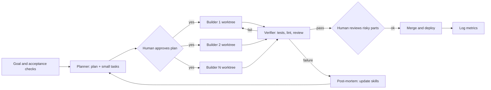

# Design: the agent work environment

## Goal

Maximize verified output per human hour, without lowering quality or safety.
The human does what agents are bad at (choosing what to build, judging risk, accepting results). The agents do what they are good at (writing, searching, testing, repeating).

## Roles

| Role | Who | Owns |
|---|---|---|
| Product owner and reviewer | Me | Goals, acceptance criteria, final approval, risk decisions |
| Planner agent | Agent | Turns a goal into a plan and small tasks with checks |
| Builder agents (1 to N) | Agents, each in its own git worktree | Implement one task each, in parallel |
| Verifier agent | A different agent, fresh context | Runs tests, reviews the diff, tries to break it |
| Memory | Files in the repo | `AGENTS.md`, `skills/`, code graph, task log |

The builder never judges its own work. A separate verifier does.

## The loop

Rules of the loop:

1. **No code before an approved plan.** The plan is a short file with tasks and checks. I read it and say yes or no.
2. **Small tasks.** Each task fits in one reviewable diff and has a check that can fail (a test, a command, a query).
3. **Parallel by default.** Independent tasks run at the same time, each in its own worktree, so agents do not step on each other.
4. **Verification is a different agent plus a machine.** Tests and linters decide first, a verifier agent reviews the diff second, and I look at anything risky third.
5. **Everything is logged.** Each task writes one line in the task log (see METRICS.md). No log, no credit.

## Autonomy ladder

An agent starts low and moves up only after a good record.

| Level | Name | What the agent may do |
|---|---|---|
| L0 | Observe | Read code and logs, summarize |
| L1 | Recommend | Write plans, docs, pull requests. No commands that change state |
| L2 | Approve-to-execute | Propose a command or migration. It waits for my "approved" |
| L3 | Guardrailed auto | Act alone inside hard limits (scope, budget, no production data) |

New kinds of work start at L1 or L2. I promote a kind of work to a higher level after several clean weeks (tests green, no rollback). One serious incident moves it back down.

## Guardrails (enforced by tools, not by trust)

- **Scope:** an agent may change only the paths named in its task. Everything else is read-only.
- **Secrets:** agents never read `.env`, keys or production dumps. Test data only.
- **Destructive commands** (force push, drop table, rm -rf, production deploy) need an explicit human approval.
- **Branches:** agents work on feature branches. Only I merge to `main`.
- **Budget:** a token and time limit per task. If the limit is hit, the agent stops and reports.
- **Kill switch:** I can stop all agents at any time and the log shows what each was doing.

## Memory and context

Agents forget between sessions, so the environment remembers for them.

- `AGENTS.md` / `CLAUDE.md`: how to build, test and deploy this repo, code style, what not to touch.
- Skills (small markdown files): repeatable procedures such as "add a Celery task", "write a migration safely", "review a diff". When a task fails, the lesson becomes a new rule in a skill (the self-improvement loop).
- A code graph (Graphify) so the agent queries the structure of the project instead of re-reading every file. I have not measured how much this saves yet, and METRICS.md has an experiment to do that.

## Cadence

- **Daily (15 min):** read yesterday's log, approve queued plans, check failures.
- **Weekly (60 min):** compute the metrics, compare with the baseline, decide what to automate or promote next.
- **After every failure:** a post-mortem (template in `templates/`) that ends in a skill or guardrail change.

## What I automate first (Pareto)

The 20% of work that costs 80% of my time: writing tests, boilerplate endpoints and migrations, log triage, release notes, refactors that touch many files, and first-pass code review. I leave architecture decisions and anything with money or user data to humans.

## Failure modes I design against

| Failure | Defence |
|---|---|
| Agent writes plausible but wrong code | Tests first, separate verifier, I review risky parts |
| Agents conflict | One worktree per task, small tasks, rebase before merge |
| Silent scope creep | Path scope limit, diff size limit per task |
| Cost runaway | Per-task budget and stop |
| Skill rot | Weekly review of skills, delete rules that no longer help |
| Me becoming the bottleneck | Track "review wait time" as a metric, batch reviews, raise autonomy where the record is clean |
