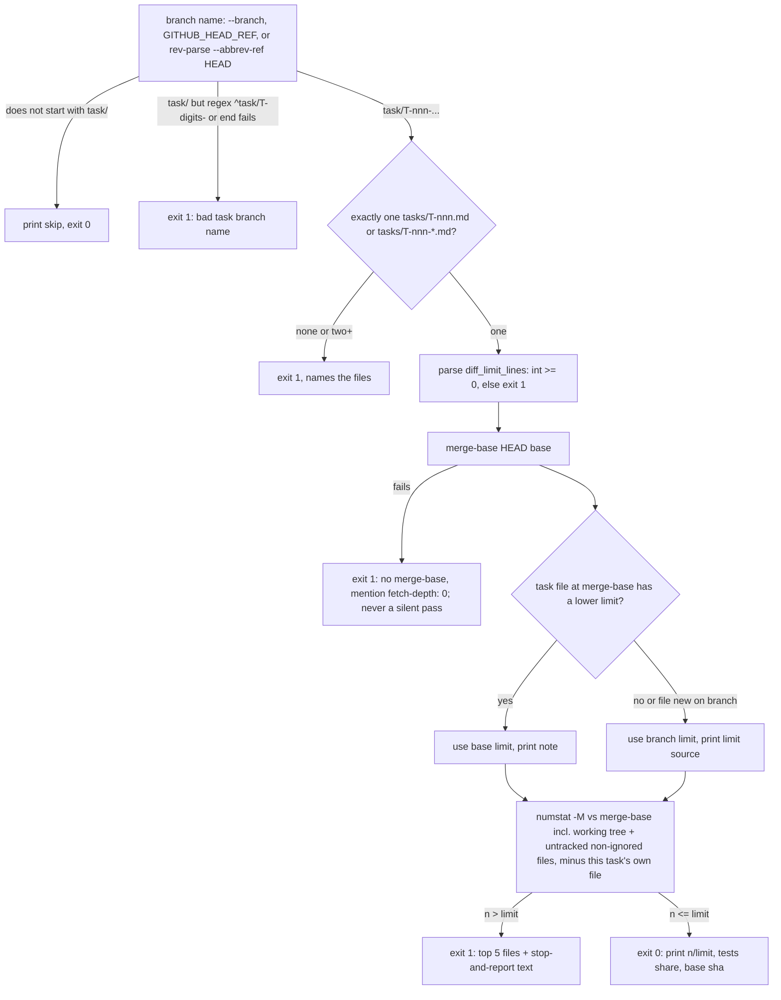

# Diff limit check (T-008, decision 0003)

How `scripts/check_diff_limit.py` decides. Local runs come through `scripts/check.py` (last check). CI runs it with `--github` in the `diff-limit` job (T-009).

In CI the checkout is GitHub's test merge commit, so the diff against the merge-base with `origin/<base>` is exactly what the PR would add to the base.
