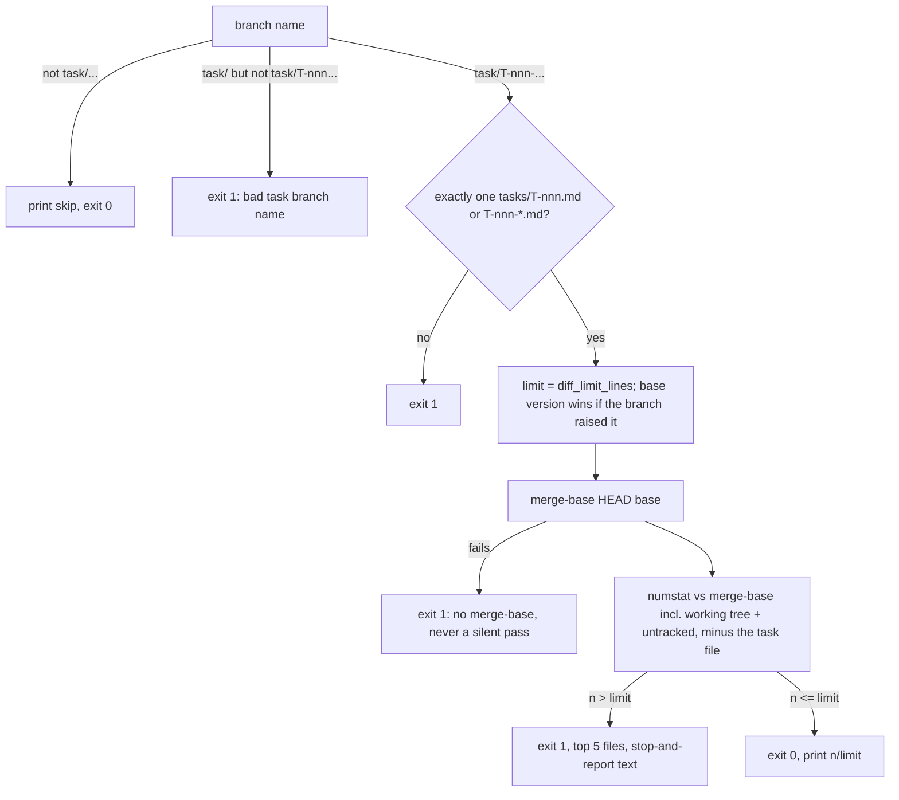

# git_metrics.py fixes, baseline re-check, and a hard diff limit

## Goal
Human request 2026-10-17, three parts:
- **A.** Fix the 3 bugs that T-003 pinned as strict xfail tests in `scripts/git_metrics.py`. Traces to headline number 1 in METRICS.md ("git-level output per active day"), which this script computes.
- **B.** Check whether these bugs moved any number in `docs/baseline.md`, including the 2.4x to 2.7x per-active-day comparison. Record the result, including "no change".
- **C.** Make `diff_limit_lines` a mechanical hard stop. Every builder from T-002 to T-006 hit or passed the limit: T-002 713/600 (waived), T-006 293/250, T-003 reached 220 by joining a line and adding `# fmt: skip  # noqa: E501`, and T-004 trimmed tests to fit 160.

**Recommendation: split.** The three parts touch different files, B is human-gated and runs on another repo, and A + C together come to about 450 lines, well over the 300-line session cap. **This file is the builder task for part A only**, so the frontmatter, scope and acceptance criteria below cover A. Parts B and C are specified here so the human can approve the design. Each becomes its own task file after approval (see "Proposed split" in Planning notes). If the human rejects the split, this file must not go to a builder as one task, because it does not fit one session.

---

## Part A (this builder task)

### Scope (paths the builder may touch)
- `scripts/git_metrics.py`
- `tests/test_git_metrics.py`
- `pyproject.toml`: only the comment on the `per-file-ignores` line for `scripts/git_metrics.py`. It says "AST identical to the original", which stops being true. New text: `# From the reference design (decision 0001); behavior changed by T-007 (author email, merges from all refs, stash excluded).` Keep the ignore list itself unchanged.
- this task file: `status` and the Log section only

Nothing else. `scripts/git_metrics.py` is on the AGENTS.md "Do not touch" list ("changes need a task"). **This is that task.** The AGENTS.md line stays as it is. Do **not** edit `session-log/tasks.csv`, because the orchestrator writes the row after merge. Do not run the script on any real repo, this one included. Use only `tmp_path` repos.

### Specification
1. **`--author` matches name or email.** Add `%ae` to the non-merge format: `\x1e%H\x1f%ad\x1f%an\x1f%ae\x1f%s\x1f%b\x1f`, then split into 7 fields. A commit is kept when `needle in name.lower() or needle in email.lower()`, where `needle = a.author.lower()`. Match each field on its own and never a joined `"name <email>"` string, so `dev <dev` matches nothing. Put the predicate in one small function, `author_matches(needle, name, email) -> bool`. Commits and merges both use it.
2. **Merges come from all refs, stash excluded.** Both `git log` calls use the same ref set, `ALL_REFS = ("--exclude=refs/stash", "--all")`. This is the constant `historic_baseline.py` already uses. A stash is a merge-shaped commit (`WIP on ...`), and its index and untracked parts are non-merge commits. So the existing non-merge call with bare `--all` already counts stash commits. That is a **fourth bug**, and this task fixes it too, because adding bare `--all` to the merges call would count every stash as a merge. Order matters: `--exclude` must come before `--all`.
3. **Merges follow `--author` (decision).** T-003 pinned that merges ignore `--author`. Change it so that merges are filtered with the same `author_matches`. Reason: with `--author`, each row should describe that author's activity, and a merge made by someone else is not their activity. Without `--author` nothing changes. The merges call becomes `log ALL_REFS --merges --date=short --pretty=format:%ad%x1f%an%x1f%ae`, parsed with `.splitlines()` and then `.split("\x1f")`. Do not use `.split()`, because names contain spaces. The `merges` column is not published in `docs/baseline.md`, so this decision cannot move a published number (part B confirms this).
4. **Empty repo.** With `ALL_REFS` on both calls, `git log` on a repo with no refs exits 0 and prints nothing. Expected: `total_commits == 0`, `months == []`, stdout is the header line only, and `--out` JSON is still written. If some git version on CI still exits 128, do not add a `try/except` around everything. Add one guard before the two log calls instead: `git for-each-ref --count=1` (read-only) and, if it prints nothing, take the empty result path. Record this in the Log.
5. **Not a repo** keeps raising `CalledProcessError` (pinned by `test_not_a_repo`, unchanged).
6. **Unchanged:** NOISE, TEST, FIX, FEAT, the author-date (`%ad`) month rule, rounding, the JSON keys, the stdout format, and the rule that a month appears only if it has non-merge commits (merges in a month with no commits are not shown).

### Acceptance criteria
- [ ] The three `xfail` markers are removed. `test_author_filter_email`, `test_merge_not_on_head` and `test_empty_repo` pass as normal tests, with the intended assertions T-003 wrote (extended as in the table below).
- [ ] `test_author_filter_name` now asserts `merges == 0` in 2026-02, with the comment `# T-007: merges follow --author`.
- [ ] `test_months_match_fixture`, `MONTHS` and the fixture builder are unchanged. The no-argument output on the T-003 fixture is identical before and after.
- [ ] Every edge-case row below has a test, or is n/a with a reason.
- [ ] Each new test fails on `main` for the stated reason before the fix. Paste one failure line per test into the Log.
- [ ] No new `# noqa`, `# type: ignore`, `# fmt: skip` or `# fmt: off` to save lines. Any suppression needs a one-line reason, and the verifier must agree it is not there to fit the limit.
- [ ] Parametrize ids are at most 20 characters.
- [ ] Diff at most 120 lines (insertions plus deletions against the merge-base with `main`, not counting this task file). **If you reach the limit, stop and report. Do not trim tests or join lines to fit.**
- [ ] `uv run python scripts/check.py` passes on CI (Linux, macOS, Windows).

### Edge cases (part A)
| Case | Input or state | Expected behavior | Test |
|---|---|---|---|
| Author by email | `--author dev@example.com` | `total_commits == 4`; months `["2026-01"]`; 2026-01 `merges == 0`. Merge M (Dev, 2026-02) is not shown because Dev has no 2026-02 commits (pinned month rule) | `test_author_filter_email` (xfail removed, asserts extended) |
| Email, other case | `--author DEV@EXAMPLE.COM` | Same as above | same test, parametrized (ids `lower`, `upper`) |
| Shared domain | `--author example.com` | All 5 commits; 2026-02 `merges == 1` | `test_author_filter_domain` |
| No cross-field match | `--author "dev <dev"` | `total_commits == 0`, `months == []`, no crash | `test_author_no_match` (ids `joined`, `nobody`) |
| No match at all | `--author nobody` | `total_commits == 0`, `months == []` | same test, second param |
| Merges follow `--author` (decision) | `--author other` | Commit 5 only; 2026-02 `merges == 0` (M is by Dev) | `test_author_filter_name` (assertion changed from 1 to 0) |
| Merge not reachable from HEAD | after the fixture, `side` merges `feature` with author `Other Dev`, dated `2026-02-28T23:30:00-05:00` (UTC is already March) | No args: 2026-02 `merges == 2`; no 2026-03 row. With `--author "other dev"`: 2026-02 `merges == 1` (a name with a space parses) | `test_merge_not_on_head` (xfail removed; date changed to the boundary value; one extra assert) |
| Time zone, month boundary for merges | same merge as above | Counted in the month of its own offset date (2026-02), the same rule as commits | covered by `test_merge_not_on_head` |
| Stash is not a commit or a merge | fixture, then change `app.py`, add an untracked `scratch.py`, run `git stash push -u` | Output equals the fixture output: `total_commits == 5`, `MONTHS` unchanged. Fails on `main` (the stash index and untracked commits are counted) | `test_stash_ignored` |
| Read-only with a stash | same run | `git stash list` still has 1 entry; HEAD unchanged | same test |
| Empty repo | `git init`, no commits | `total_commits == 0`, `months == []`, stdout is 1 header line, JSON has the 4 keys | `test_empty_repo` (xfail removed) |
| Unborn HEAD, other refs exist | fixture, then `git checkout -q --orphan fresh` (no commit) | Same `months` as the fixture | `test_unborn_head` |
| Not a repo | plain dir | `CalledProcessError` (pin, unchanged) | `test_not_a_repo` (unchanged) |
| No args unchanged | full fixture | `MONTHS` and `total_commits == 5` exactly as before | `test_months_match_fixture` (unchanged) |
| Retry / duplicate | run twice | Same output | `test_deterministic` (unchanged) |
| Concurrent | two runs at once | n/a: read-only `git log`, no shared state | n/a (by design) |
| Permissions | unwritable `--out` | n/a: raises `OSError` as before; chmod is not portable to Windows | n/a |
| Maximal | thousands of commits | n/a: still two `git log` calls (three with the empty-repo guard), linear parsing | n/a (by design) |

### Test plan
- Tests first: remove the three xfail markers, extend them as in the table, add `test_author_filter_domain`, `test_author_no_match`, `test_stash_ignored` and `test_unborn_head`. Run `uv run pytest tests/test_git_metrics.py` on the unchanged script and paste one failure line per test into the Log. `test_author_no_match` may pass on `main`. Note that in the Log, since it guards the fix against a joined-string implementation.
- Reuse the existing `git`, `commit` and `run` helpers. The stash needs a committer identity, and `git()` already sets one through `env`.
- Command: `uv run python scripts/check.py`.

### Builder notes
- Keep the script's style (it is excluded from E401/I001/E501/B007/UP). Make the smallest change that works, and do not reformat untouched lines.
- `install.py` copies `scripts/git_metrics.py` into the bootstrap `reference/` folder. The fix reaches other projects only when the human runs the installer again. That is not in scope.

---

## Part B (human-gated; not builder scope; proposed T-010)

**Question:** did the four bugs (author by name only, merges only from HEAD, empty-repo crash, stash commits counted) change any published number in `docs/baseline.md`?

**What can and cannot move:**
- The `merges` column is not published in either table, so the merge fixes cannot move a published cell.
- The empty-repo crash cannot have happened, because the run produced numbers.
- `--author` by email: if an email had been used, the run would have produced 0 commits, so it was not. If a name substring was used, the fix can only add commits whose email matches and whose name does not.
- Stash: if the source repo had a `refs/stash` at the time of the run, the stash index and untracked commits were counted as commits and lines. **This is the only bug that can plausibly have moved a published cell.**

**Steps (orchestrator, only on the human's request in the session, read-only on the source repo, the same pattern as the T-002 calibration):**
1. Before and after: record `git -C <src> rev-parse HEAD`, `git status --porcelain | count` and `git for-each-ref | count`. They must be identical at the end.
2. Old script: `git show <last main commit before T-007>:scripts/git_metrics.py` into the scratchpad. New script: `main` after T-007. Both run on the **same** repo state with the **same** arguments, writing `--out` to the scratchpad. Nothing from the source repo enters this repo.
3. **Was `--author` used?** Run the old script with no `--author`. If the closed months (2025-06 to 2026-09) match the published table cell for cell, then `--author` was not used. If they do not match, the human names the alias substrings to try. If none matches, record "not reproducible" and the size of the gap, and do not recompute the ratio from mixed sources.
4. **Effect of the fix** = new(now) minus old(now), per month and per column, on the same repo state. This separates the fix from commits added since 2026-10-10. (The published 2026-10 row was partial, "to the 10th", so it cannot be compared directly.)
5. Report whether `refs/stash` exists (yes/no and count only), and the totals of the merges column before and after the cutoff, old and new.
6. If no published cell changes, record "no change". If any does, recompute the "Two periods" table and the per-active-day ratio, and write the old and new values side by side. Never overwrite the original table silently.

**Record (T-010 scope: `docs/baseline.md` only):** add a short subsection "Re-check after the git_metrics fixes (date)" under "Two periods compared". It holds the arguments used (no `--author`, or "a name substring"), whether a stash existed, the number of changed published cells (expected: 0), the merges totals old and new (aggregates only), and the ratio, unchanged or old to new. Never name the source repo, a path, an author name, an email or a commit subject (AGENTS.md "Public repo"). Metrics data is L1: the agent proposes the text and the human confirms it.

| Case | Input or state | Expected behavior | Check |
|---|---|---|---|
| No change (expected) | no stash, `--author` not used | Closed months reproduce exactly; new minus old is 0 in every published column; only `merges` differs | Record "no change" plus the merges totals |
| Stash present | `refs/stash` exists | Commits and lines drop by the stash's index and untracked commits in their months | Changed cells are listed; two-period table and ratio recomputed, old and new side by side |
| `--author` used with a name | old(now) without `--author` does not match the closed months | Try the human's alias substrings; use the ones that reproduce the table for both runs | Arguments recorded as "a name substring" (never the name) |
| Not reproducible | no argument set matches the closed months | Record the gap; do not recompute the ratio | Human decides whether to rebuild the baseline |
| Source repo moved since 2026-10-10 | new commits, maybe new branches | Only new(now) minus old(now) is used for the effect; the published 2026-10 row is not compared | Built into step 4 |
| Time zone / day boundary | month split by author date in its own offset | Both versions use the same `%ad` rule, so no month shift is expected. A shift in a boundary month is a finding | Per-month diff in step 4 |
| Partial failure | either run raises | Stop and report; no docs edit | n/a |
| Retry / duplicate | run each version twice | Identical output | Compare the JSON files except `generated` |
| Read-only / permissions | source repo | HEAD, status count and ref count unchanged; output only in the scratchpad | Step 1 |
| Privacy | committed text | Aggregates only; no names, paths, emails or subjects | Verifier greps the diff |

---

## Part C (proposed T-008 script + check.py, T-009 CI + rules; not this builder's scope)

### C1 / T-008: `scripts/check_diff_limit.py`

- CLI: `uv run python scripts/check_diff_limit.py [--root DIR] [--branch NAME] [--base REF] [--github]`. `main(argv: list[str] | None = None) -> int`. Stdlib only, read-only, every git call is `git -C <root>` with list arguments.
- Constants: `TASK_BRANCH = re.compile(r"^task/(T-\d+)(?:-|$)")`, `DEFAULT_BASE = "main"`, `TOP_FILES = 5`.
- Branch: `--branch`, else `git rev-parse --abbrev-ref HEAD`. Anything not starting with `task/` (`main`, `HEAD` when detached, `feature/x`) means skip, exit 0. A `task/` branch the regex does not match exits 1, so a typo cannot switch the check off.
- Task file: `tasks/<id>.md` or `tasks/<id>-*.md`, the same rule as the validator. Exactly one, else exit 1. Read `diff_limit_lines` with `parse_frontmatter`, imported from `validate_agent_layer` the way `historic_baseline.py` imports from `git_metrics`. It must be `int(value) >= 0`, else exit 1.
- **A limit raised on the branch does not count.** If the task file exists at the merge-base (`git show <mb>:tasks/<file>`) with a lower value, use the base value and print a note. Raising the limit is a human decision. It happens on `main` or by the human merging a red PR, and it is recorded in the Log.
- Lines: `git diff --numstat -M <mb>` (committed, staged and unstaged tracked changes) plus untracked non-ignored files from `git ls-files --others --exclude-standard -z`, read as bytes. A file with a NUL in its first 8000 bytes counts 0 lines. Otherwise count `b"\n"`, plus 1 if the file is non-empty and does not end in a newline. Binary numstat (`-\t-`) counts 0. The sum is insertions plus deletions.
- **Excluded: the task's own file only.** Builders may change only its `status` and Log, and Logs grow with every honest attempt (T-003's Log has 4 attempts). Counting it would push builders toward short logs. The verifier still checks that only `status` and Log changed. Nothing else is excluded: tests count, because review load is what the limit is for. `session-log/tasks.csv` counts too, since builders must not touch it.
- Output: `diff limit: 212/300 lines (tests 130; base abc1234; task file excluded)`, where tests are counted with `TEST` from `git_metrics`. When over the limit, also print the top 5 files and `Over the limit: stop and report. Do not trim tests, join lines or add lint suppressions to fit (AGENTS.md).`
- `--github`: branch from env `GITHUB_HEAD_REF`, base `origin/<GITHUB_BASE_REF>`. If either is missing, exit 1. The values come from env, never from shell interpolation, so a hostile fork branch name cannot inject commands.
- `scripts/check.py`: add `("diff limit", [PY, "scripts/check_diff_limit.py"])` as the **last** check, so a builder sees every other result first. In CI the PR checkout is a detached `HEAD`, so this step skips there. CI enforcement is C2.
- Scope: `scripts/check_diff_limit.py` (new), `tests/test_check_diff_limit.py` (new), `scripts/check.py`, and its own task file (status and Log). Tests import `clean_env`, `git` and `commit` from `tests.test_git_metrics` instead of copying them.

| Case | Input or state | Expected behavior | Test |
|---|---|---|---|
| Not a task branch | `main`, `feature/x`, detached `HEAD` | `skip: not on a task branch`, exit 0 | `test_skip_non_task` (ids `main`, `feature`, `detached`) |
| Bad task branch name | `task/t-007-x`, `task/foo` | Exit 1, names the expected pattern | `test_bad_task_branch` |
| No task file | `task/T-009-x`, no `tasks/T-009*.md` | Exit 1 | `test_task_file_missing` |
| Two task files | `T-001-a.md` and `T-001-b.md` | Exit 1 naming both | `test_task_file_ambiguous` |
| Id prefix trap | branch `task/T-001-x`, file `T-0010-y.md` only | Not matched, exit 1 | same test, param |
| Bad limit | empty, `abc`, `-5`, `300.0` | Exit 1 | `test_bad_limit` (ids `empty`, `text`, `neg`, `float`) |
| Under / equal / over by one | limit 10; diffs of 9, 10, 11 lines | Exit 0, 0, 1; over prints the top files and the stop text | `test_limit_boundary` (ids `under`, `equal`, `over`) |
| Task file excluded | Log grows 50 lines, code 5 lines, limit 10 | Exit 0, counts 5 | `test_task_file_excluded` |
| Other task file counted | branch edits `tasks/T-002-*.md` | Counted | same test, param |
| Limit raised on branch | base has `diff_limit_lines: 10`, branch sets 100, diff 20 | Uses 10, prints a note, exit 1 | `test_raised_limit_ignored` |
| Task file new on branch | not present at merge-base | Branch value used; prints `limit source: branch` | same test, param |
| Uncommitted tracked change | edit without commit | Counted | `test_working_tree_counted` |
| Untracked file | new 7-line file, not ignored; a 3-line file with no final newline | Counts 7 and 3 | same test |
| Ignored file | `.venv/x`, `coverage.json` in `.gitignore` | Not counted | same test, param |
| Binary file | tracked and untracked files with a NUL | 0 lines, no crash | `test_binary_zero` |
| Rename | `git mv a.py b.py`, no edit | 0 lines | `test_rename_zero` |
| Main moved ahead | 30 lines committed on `main` after branching | Not counted (merge-base) | `test_merge_base_not_main_tip` |
| Main merged into branch | branch merges `main` | Only the branch's own lines | same test, param |
| No base | `--base nope` or a shallow clone | Exit 1, message mentions `fetch-depth: 0`; never a silent pass | `test_no_merge_base` |
| CI mode | `--github` with env `GITHUB_HEAD_REF=task/T-001-x` and `GITHUB_BASE_REF=main` (a `origin/main` ref made in the fixture) | Same result as local; env missing gives exit 1 | `test_github_mode` (ids `ok`, `noenv`) |
| Worktree | run inside `git worktree add` of the task branch | Same count as in the main checkout | `test_worktree` |
| Concurrent | 3 builders in 3 worktrees | n/a: read-only, per-worktree state, no temp files | n/a (by design) |
| Retry | run twice | Same output | covered by `test_limit_boundary` (call twice in one param) |
| Permissions | unreadable untracked file | n/a: `OSError` propagates and check.py fails loudly (a hard stop must not undercount); chmod is not portable to Windows | n/a |
| Maximal | a 10,000-line diff | n/a: one numstat call plus one `ls-files`, linear | n/a (by design) |
| Line endings | CRLF untracked file on Windows | Counted by `\n`, the same on every OS | covered by `test_working_tree_counted` (bytes written explicitly) |

### C2 / T-009: CI job and rule text (guardrail path; human applies via the permission prompt)
- `.github/workflows/ci.yml` (an `ask` path): a new job `diff-limit` with `if: github.event_name == 'pull_request'`, `runs-on: ubuntu-latest` (one OS is enough), `actions/checkout@v4` with `fetch-depth: 0`, `setup-uv`, then `run: uv run python scripts/check_diff_limit.py --github`. Keep `permissions: contents: read`, and never use `pull_request_target`. The existing `check` job does not change. Making the job a required check is a GitHub setting for the human.
- Rule text: `AGENTS.md` workflow step 5 ("the diff limit is a hard stop enforced by `check_diff_limit.py`; over the limit, stop and report; never trim tests, join lines or add lint suppressions to fit; only the human raises a limit"), plus a line in the Commands table. `.claude/agents/builder.md` step 7 gets the same rule. `.claude/agents/planner.md` step 4 and `.claude/skills/plan-task/SKILL.md` Step 2 get a sizing note: "about 8 lines per edge-case row with a real fixture, plus about 30 for a new fixture helper, plus the code. Split when the total is over 300." `.claude/skills/verify-diff/SKILL.md` gets a step: grep the added lines for `noqa|type: ignore|fmt: skip|fmt: off` and check each one, and check that the task file changed only in `status` and Log. `tasks/_template.md` gets a comment on `diff_limit_lines`: `# hard stop (scripts/check_diff_limit.py); task file not counted`. `CONTEXT.md` adds the new script to the scripts list.
- Edge cases: a fork PR on a `task/` branch is counted and is harmless (read-only token). A PR from a non-task branch skips with a visible line. A PR to a base other than `main` uses `origin/<base_ref>`. A branch name with shell metacharacters is safe, because it is read from env. `validate_agent_layer` still passes on the changed template (`test_real_repo_agent_layer_is_valid`).

---

## Log (filled in by the builder and verifier)
- Start / end:
- Failing tests before the fix (one line each):
- Checks run (command and real output):
- Diff size (insertions + deletions vs merge-base, task file excluded):
- Verifier verdict and findings:
- Human review (minutes, notes):

## Planning notes
- **People / Process / Technology:** People: the human stops waiving size overruns one by one, and the baseline the 10x answer rests on gets an explicit re-check. Process: the diff limit moves from builder discretion to `check.py` and CI, and only the human can raise a limit. Technology: about 15 changed lines in `git_metrics.py`, one new stdlib script of about 100 lines, and one CI job.
- **Pareto:** A is cheap and closes the known correctness gaps in the headline script. In C, the local `check.py` step (T-008) is the 20% that does 80% of the work, because every builder and verifier already runs `check.py`. The CI job (T-009) only closes the "builder skipped check.py" gap. B is mostly expected to confirm "no change", but it is the only way to know.
- **Revenue / Risk / Cost:** no revenue. Risks: (1) A changes headline-number code, so B exists. (2) C can turn every in-flight branch red, so it is merged when no builders are running. (3) A builder that does not name its branch `task/...` skips the local check, which T-009's CI job and the verifier catch. Cost: about 4 builder sessions plus one orchestrator run.
- **Proposed split** (run order: T-007 and T-008 in parallel; then T-009 and T-010 in parallel; at most 2 at once):

| id | part | scope (exact paths) | blocked_by | parallel_ok | diff_limit_lines | est_hours_old_way | risk |
|---|---|---|---|---|---:|---:|---|
| T-007 (this file) | A: git_metrics fixes | `scripts/git_metrics.py`, `tests/test_git_metrics.py`, `pyproject.toml` (one comment), this task file (status, Log) | none | yes | 120 | 1 | medium |
| T-008 | C1: `check_diff_limit.py` + `check.py` | `scripts/check_diff_limit.py` (new), `tests/test_check_diff_limit.py` (new), `scripts/check.py`, its task file (status, Log) | none | yes | 300 | 2 | low |
| T-009 | C2: CI job + rule text | `.github/workflows/ci.yml` (ask path, human-applied), `AGENTS.md`, `CONTEXT.md`, `.claude/agents/builder.md`, `.claude/agents/planner.md`, `.claude/skills/plan-task/SKILL.md`, `.claude/skills/verify-diff/SKILL.md`, `tasks/_template.md`, its task file (status, Log) | T-008 | yes | 80 | 0.75 | medium (guardrail path) |
| T-010 | B: baseline re-check | `docs/baseline.md` (one new subsection). The run itself is an orchestrator step on the human's request, outside builder scope | T-007 | yes | 40 | 0.5 | low |

  Total if split: about 4.25 h (old way). Not split: the same work does not fit one session. It would be about 450 lines and the guardrail path would block the whole PR.
- **Estimate basis (`est_hours_old_way: 1`, part A):** 15 min to confirm the git behaviours (stash shape, `--all` on an empty repo, `--exclude` order), 15 min for the code, 30 min for the four new tests and the three converted ones on the existing fixture. This is realistic per the T-002 calibration. It is a planning aid only (METRICS.md headline note). T-008 (2 h): 45 min for the script (merge-base, untracked bytes, base-version limit), 75 min for about 20 fixture tests. T-009 (0.75 h): 15 min of YAML, 30 min of rule text in 7 files. T-010 (0.5 h): two runs, a diff and one paragraph.
- **Size basis (part A, 120 lines):** about 30 lines changed in the script (counting insertions and deletions), about 55 in tests (4 new tests at about 8 lines, 3 converted ones at about 5, plus parametrize), and 2 in `pyproject.toml`. That is about 87, leaving a margin of about 30%. T-008: about 100 script lines plus 25 rows at about 6 lines (parametrized, shared helpers imported) is about 250 to 270 lines, which is tight against 300 on purpose. If it goes over, the builder stops. The proposed split for that case is moving the `--github` mode and its test into T-009.
- **Decisions to record after approval** (not written now, because this request allows one file only): `docs/decisions/0003-diff-limit-hard-stop.md` (exclude only the task file, the base version of the limit wins, local check plus CI job, no mechanical lint-suppression ban but verifier review). Also a note under decision 0001 that `git_metrics.py` now differs from the reference design in behavior, not only formatting.
- **Assumptions:** git >= 2.20 on all CI runners (for `--exclude` with `--all`, and `-M` numstat). Builders keep naming branches `task/<id>-<slug>` (builder.md step 2). Task files for approved tasks may or may not be on `main` before the builder starts. If not, the base-version limit protection does not apply, and T-008 prints `limit source: branch` so the verifier can see it.
- **Open risks:**
  1. The AGENTS.md line "copied unchanged from the reference design" becomes inaccurate after A. The human asked to keep it, so T-009 could reword it to "derived from the reference design" if the human agrees.
  2. The hard stop moves the waiver decision to the human at merge time. A red local check means the builder cannot report green, and that is intended. If CI's `diff-limit` job becomes a required check, a waived overrun needs either an admin merge or a limit raise committed on `main`.
  3. A stash in the source repo is the only plausible way the published baseline moved. If B finds one, the 2.4x to 2.7x ratio is recomputed. It is expected to move only slightly, because stash commits are few.
  4. `--all` on an empty repo is assumed to exit 0 on every OS's git. Spec item 4 gives the fallback.
